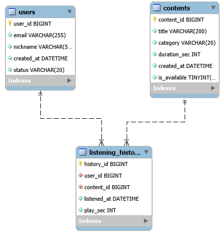
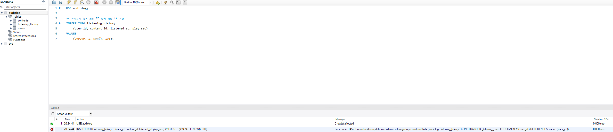
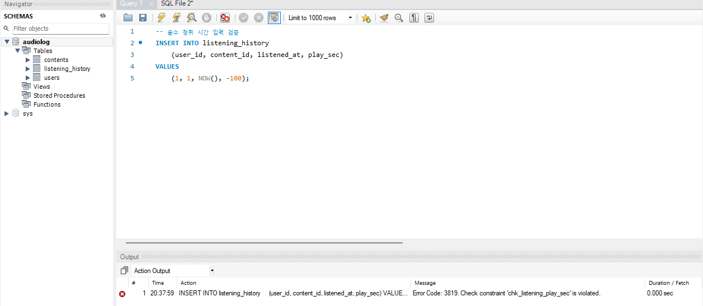
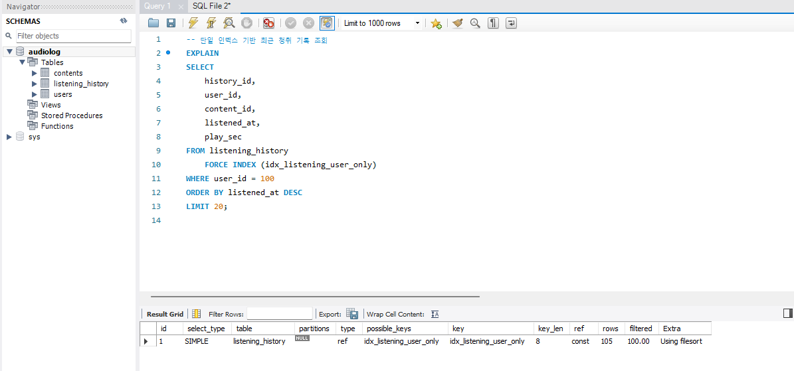
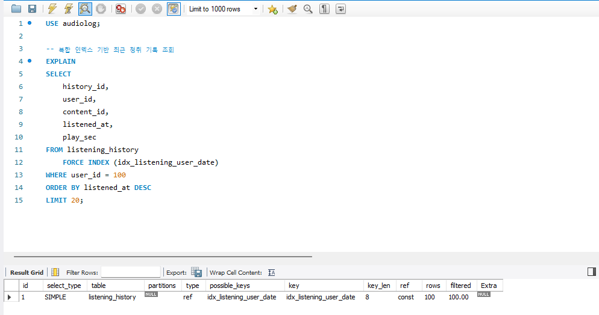
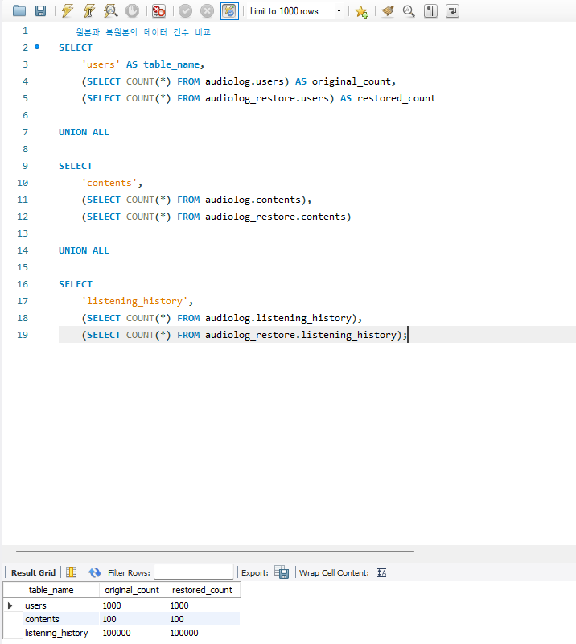
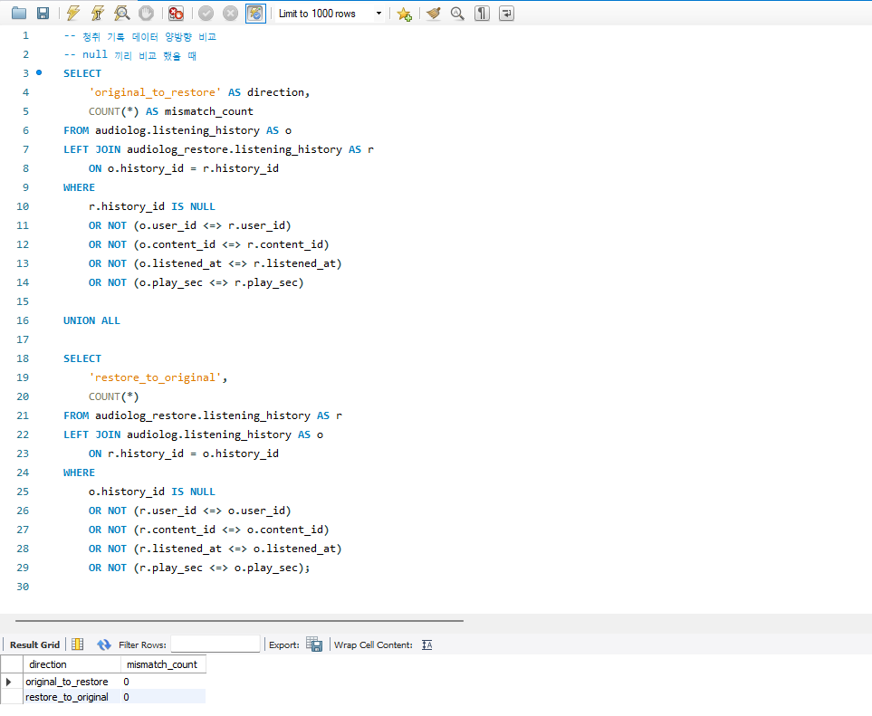
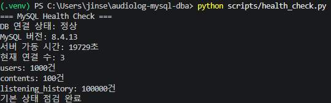

# AudioLog MySQL DBA Lab

> **가상 오디오 콘텐츠 서비스의 청취 기록 DB 설계·데이터 검증·인덱스 튜닝·백업 및 복원 실습**

본 프로젝트는 가상의 오디오 콘텐츠 서비스를 대상으로 MySQL 데이터베이스의 설계, 데이터 무결성 검증, 대량 데이터 적재, 조회 성능 비교, 논리 백업·복원 및 기본 상태 점검을 진행한 **개인 학습 프로젝트**입니다.

게임 QA 업무에서 CSV 데이터를 MySQL에 적재하고 JOIN·중복·정합성을 검증한 경험을 바탕으로, 데이터베이스의 구조와 운영에 필요한 기초 개념을 직접 실습하고 결과를 기록했습니다. **특정 기업의 내부 시스템을 재현한 것이 아니며, 실제 서비스 운영 경력을 의미하지 않습니다.**

## 목차
1. [실습 환경 및 데이터](#1-실습-환경-및-데이터)
2. [DB 설계](#2-db-설계)
3. [데이터 무결성 검증](#3-데이터-무결성-검증)
4. [Python 대량 데이터 생성](#4-python-대량-데이터-생성)
5. [인덱스 실행 계획 및 성능 비교](#5-인덱스-실행-계획-및-성능-비교)
6. [백업·복원 검증](#6-백업복원-검증)
7. [Python 상태 점검](#7-python-상태-점검)
8. [트러블슈팅 및 학습 내용](#8-트러블슈팅-및-학습-내용)
9. [파일 구성 및 실행 시 유의사항](#9-파일-구성-및-실행-시-유의사항)

## 1. 실습 환경 및 데이터

| 구분 | 환경 |
|---|---|
| OS | Windows / PowerShell |
| DBMS | MySQL 8.4.13 (InnoDB) |
| 실행 환경 | Docker Desktop |
| DB 도구 | MySQL Workbench |
| 언어 | SQL, Python |
| Python 패키지 | mysql-connector-python, Faker, python-dotenv |
| 백업 도구 | mysqldump |

| 테이블 | 데이터 건수 | 설명 |
|---|---:|---|
| `users` | 1,000 | 가상 회원 |
| `contents` | 100 | 가상 오디오 콘텐츠 |
| `listening_history` | 100,000 | 가상 청취 기록 |
| **합계** | **101,100** | 생성·점검 시 확인한 건수 |

데이터는 실제 사용자의 청취 로그가 아닌 Python으로 생성한 **합성 데이터**입니다. 청취 기록은 5,000건 단위 배치 INSERT와 COMMIT으로 적재했습니다.

## 2. DB 설계

회원(`users`), 콘텐츠(`contents`), 청취 기록(`listening_history`)을 분리하고, 청취 기록이 회원 및 콘텐츠를 외래키로 참조하도록 모델링했습니다. 회원 1명과 콘텐츠 1개는 각각 여러 청취 기록에 연결될 수 있습니다.



**설계 기준**
- `user_id`, `content_id`, `history_id`를 PK로 설정
- `listening_history.user_id`, `listening_history.content_id`를 FK로 설정
- 회원 이메일 중복 방지를 위한 `UNIQUE` 적용
- 회원 상태, 콘텐츠 유형, 재생 시간 등에 `CHECK` 적용
- 동일한 회원이 동일한 콘텐츠를 여러 번 청취할 수 있으므로 청취 기록의 `(user_id, content_id)`에는 `UNIQUE`를 설정하지 않음

스키마 정의: [01_create_tables.sql](sql/01_create_tables.sql)

## 3. 데이터 무결성 검증

정상적인 데이터 입력뿐 아니라 **의도적으로 잘못된 데이터를 INSERT**하여 제약조건이 입력을 거부하는지 확인했습니다.

| 검증 항목 | 예상·관측 오류 코드 | 확인 결과 |
|---|---:|---|
| 이메일 중복 (`UNIQUE`) | 1062 | 입력 거부 |
| 필수 이메일 `NULL` (`NOT NULL`) | 1048 | 입력 거부 |
| 허용되지 않은 회원 상태 (`CHECK`) | 3819 | 입력 거부 |
| 존재하지 않는 회원/콘텐츠 ID (`FK`) | 1452 | 입력 거부 |
| 음수 청취 시간 (`CHECK`) | 3819 | 입력 거부 |

### FK 검증

존재하지 않는 회원을 참조한 청취 기록 입력 시 MySQL이 오류 1452를 반환했습니다.



### CHECK 검증

음수의 청취 시간을 입력했을 때 오류 3819로 차단되는 것을 확인했습니다.



검증 SQL: [02_constraints_test.sql](sql/02_constraints_test.sql) — 오류를 유도하는 INSERT는 안전한 재실행을 위해 주석 처리했습니다.

## 4. Python 대량 데이터 생성

`users` 1,000건과 `contents` 100건을 준비한 후, DB에서 **실제 존재하는 회원·콘텐츠 ID를 조회**하여 FK 조건을 충족하는 청취 기록 100,000건을 생성했습니다.

- `executemany()`를 사용해 5,000건 단위로 INSERT
- 배치별 `commit()`, 오류 시 미커밋 배치 `rollback()`
- 실행 시 기존 행 수를 조회해 목표 건수까지 부족한 수만 추가
- 청취 시간은 선택된 콘텐츠의 재생 시간을 초과하지 않도록 생성

소스: [generate_users.py](scripts/generate_users.py) · [generate_contents.py](scripts/generate_contents.py) · [generate_listening_history.py](scripts/generate_listening_history.py)

**실습 범위:** 배치 단위 커밋 방식이므로 중간 실패 시 이미 커밋한 배치는 유지됩니다. 여러 프로세스의 동시 실행까지 제어하는 적재 시스템은 아닙니다.

## 5. 인덱스 실행 계획 및 성능 비교

**조회 시나리오:** 특정 회원(`user_id = 100`)의 최신 청취 기록 20건 조회

```sql
SELECT history_id, user_id, content_id, listened_at, play_sec
FROM listening_history
WHERE user_id = 100
ORDER BY listened_at DESC
LIMIT 20;
```

### 단일 인덱스: `(user_id)`

단일 인덱스 사용 시 `user_id` 조건에는 인덱스를 활용했지만 `ORDER BY listened_at DESC`에 대해 `Using filesort`가 관찰되었습니다.



### 복합 인덱스: `(user_id, listened_at DESC)`

조회 조건과 정렬 순서를 함께 고려해 복합 인덱스를 구성했습니다. 실습에서 복합 인덱스를 지정한 실행 계획은 별도 `Using filesort` 없이 조회되었습니다.



### EXPLAIN ANALYZE 측정 결과

두 인덱스를 각각 지정한 동일 조회에 대해 **5회씩 실행**, 최상위 노드의 `actual time` 종료값(ms)을 기록했습니다.

| 회차 | 단일 인덱스 (ms) | 복합 인덱스 (ms) |
|---|---:|---:|
| 1 | 0.209 | 0.189 |
| 2 | 0.202 | 0.193 |
| 3 | 0.211 | 0.196 |
| 4 | 0.198 | 0.191 |
| 5 | 0.211 | 0.197 |
| **평균** | **0.2062** | **0.1932** |

평균 실행 시간은 **0.0130ms(약 6.3%) 감소**했습니다. 다만 절대 차이가 매우 작고 측정 횟수가 제한적이므로, 실습 결과를 실제 서비스에서 보장되는 성능 향상으로 일반화하지 않았습니다. 데이터 분포상 회원당 평균 청취 기록 수가 약 100건이라는 점도 고려해야 합니다.

인덱스 실습 SQL: [03_index_tuning.sql](sql/03_index_tuning.sql)

## 6. 백업·복원 검증

`mysqldump`로 `audiolog` 데이터베이스를 논리 백업한 뒤 별도의 `audiolog_restore`에 복원했습니다. 로컬 백업 파일 크기는 **4,221,131 Byte**였습니다.

백업 파일 생성 자체를 복구 성공으로 간주하지 않고, 복원 후 원본과 데이터를 비교했습니다.

### 테이블 건수 비교



원본·복원본의 회원 1,000건, 콘텐츠 100건, 청취 기록 100,000건 일치를 확인했습니다.

### 데이터 내용 및 구조 검증



- PK 기준 원본 ↔ 복원본 양방향 데이터 비교에서 불일치 **0건** 확인
- 복원본의 회원·콘텐츠 FK 참조 불일치 **0건** 확인
- PK·FK·CHECK 등 제약조건 목록과 인덱스 구성 비교 결과 일치 확인

이는 **실습 당시 백업 시점과 비교 대상 상태**에 대한 결과입니다. 지속적인 백업 자동화나 복구 목표 시간(RTO) 측정은 포함하지 않았습니다.

검증 SQL: [04_restore_validation.sql](sql/04_restore_validation.sql)

## 7. Python 상태 점검

`mysql-connector-python`으로 DB 연결 상태, MySQL 버전, 서버 가동 시간, 현재 연결 수, 주요 테이블 건수를 조회하는 스크립트를 작성했습니다.



실행 사례에서 MySQL **8.4.13**, 서버 가동 시간 **15,314초**, 연결 수 **3개**, 주요 테이블 건수 **1,000 / 100 / 100,000건**을 확인했습니다.

코드: [health_check.py](scripts/health_check.py)

본 스크립트는 **기본적인 상태 조회 도구**이며, CPU·메모리·디스크, 복제 지연, 장애 알림 등을 포함한 운영 모니터링 시스템은 아닙니다.

## 8. 트러블슈팅 및 학습 내용

### Lock wait timeout (오류 1205)
Python 회원 데이터 INSERT 과정에서 `Lock wait timeout exceeded` 오류가 발생했습니다. `information_schema.innodb_trx`와 `sys.innodb_lock_waits`를 조회하여 트랜잭션·잠금 상태를 확인했고, 미완료 트랜잭션을 점검한 후 재실행해 회원 데이터 INSERT를 완료했습니다. **정확한 잠금 원인 세션은 확정하지 않았으므로 특정 원인을 해결했다고 단정하지 않습니다.**

### FK 인덱스와 복합 인덱스
`(user_id, listened_at DESC)` 복합 인덱스를 생성한 후 기존에 자동 생성된 `user_id` FK 인덱스가 보이지 않는 현상을 확인했습니다. FK 제약조건은 유지되어 있었고, MySQL은 FK에 필요한 선행 컬럼을 제공하는 다른 인덱스가 있을 때 기존 자동 인덱스를 제거할 수 있음을 학습했습니다.

처음 복합 인덱스를 `INVISIBLE`로 전환했을 때의 측정값은 기존 단일 인덱스가 없어진 상황과 혼재할 수 있어 **공정한 단일 vs 복합 인덱스 비교로 채택하지 않았습니다**. 이후 비교용 단일 인덱스를 별도로 생성하고 각 인덱스를 지정해 재측정했습니다.

## 9. 파일 구성 및 실행 시 유의사항

```text
audiolog-mysql-dba/
├── sql/
│   ├── 01_create_tables.sql
│   ├── 02_constraints_test.sql
│   ├── 03_index_tuning.sql
│   ├── 04_restore_validation.sql
│   └── 05_sample_queries.sql
├── scripts/
│   ├── test_connection.py
│   ├── generate_users.py
│   ├── generate_contents.py
│   ├── generate_listening_history.py
│   └── health_check.py
├── screenshots/          # 실행 결과 이미지 8장
├── .gitignore
├── requirements.txt
└── README.md
```

**실습 실행 순서(신규 환경):**
1. Docker에 MySQL 8.4를 실행하고 접속 정보를 준비합니다.
2. `sql/01_create_tables.sql`을 사용해 스키마를 생성합니다.
3. `requirements.txt`의 패키지를 설치하고 프로젝트 루트에 **Git 추적 제외된** `.env` 파일을 준비합니다. 환경변수는 `DB_HOST`, `DB_PORT`, `DB_USER`, `DB_PASSWORD`, `DB_NAME`을 사용합니다.
4. Python 데이터 생성 스크립트를 회원 → 콘텐츠 → 청취 기록 순으로 실행합니다.
5. 인덱스 생성·제약조건 오류 유도·복원 검증 SQL은 **해당 실습의 전제 조건을 확인한 후 개별 실행**합니다.

일부 SQL 파일은 이미 데이터가 존재하는 환경에서 무조건 다시 실행하기 위한 배포 스크립트가 아니라 **실습 과정과 검증 쿼리를 보존한 자료**입니다. 비밀번호가 담긴 `.env` 및 실제 DB 백업 파일은 GitHub에 업로드하지 않습니다.

---

**회고:** 이번 프로젝트를 통해 데이터를 저장하는 것뿐 아니라, 무결성을 보장하는 제약조건, 실행 계획을 기반으로 한 인덱스 선택, 백업 이후의 복원 검증까지 연결하여 학습했습니다. 특히 측정 조건이 달라지면 성능 수치의 의미도 달라질 수 있으므로, 실행 계획·측정 방법·검증 범위를 함께 기록하는 습관의 중요성을 확인했습니다.
