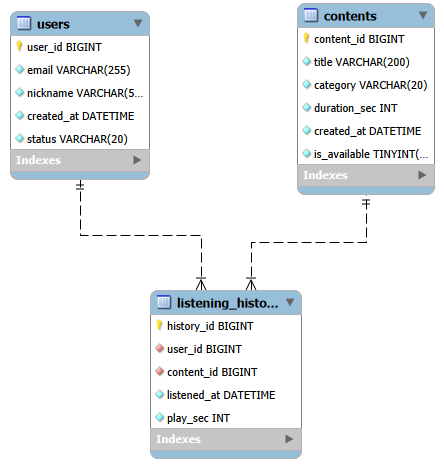

# 01. 데이터베이스 설계

## 목표
가상 오디오 서비스의 회원, 콘텐츠, 청취 기록을 중복 없이 관리할 수 있도록 테이블 3개를 설계했습니다.

## 테이블 구성
| 테이블 | 주요 컬럼 | 역할 |
|---|---|---|
| `users` | `user_id`, `email`, `status` | 회원 정보 |
| `contents` | `content_id`, `title`, `duration_sec` | 콘텐츠 정보 |
| `listening_history` | `history_id`, `user_id`, `content_id`, `listened_at`, `play_sec` | 청취 기록 |

청취 기록의 `user_id`와 `content_id`는 다른 두 테이블을 가리키는 외래키(FK)입니다. 한 회원이 같은 콘텐츠를 여러 번 들을 수 있으므로 이 두 값의 조합을 중복 금지하지 않았습니다.

## 확인한 점
- 각 테이블에 기본키(PK)를 설정했습니다.
- 이메일은 중복 저장되지 않게 `UNIQUE`를 설정했습니다.
- 회원 상태와 재생 시간 등은 `CHECK`로 제한했습니다.

**SQL:** [테이블 생성](../sql/01_create_tables.sql)
