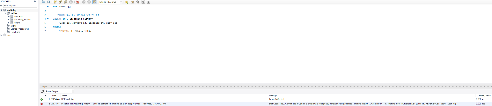
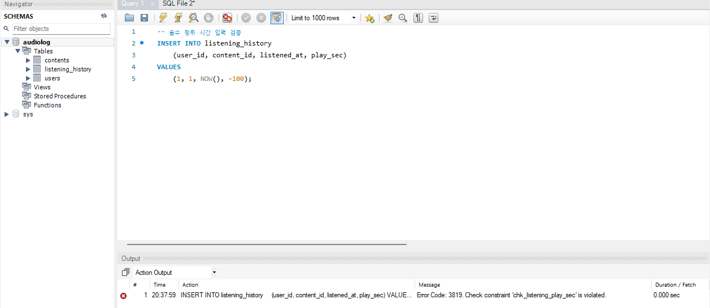

# 02. 데이터 무결성 검증

## 목적
잘못된 값을 입력했을 때 MySQL이 저장을 막는지 확인했습니다.

## 진행 방식
일부러 잘못된 데이터를 넣어 보고 오류가 발생하는지 살펴봤습니다.

| 입력한 내용 | 확인한 규칙 | 오류 코드 |
|---|---|---:|
| 이미 사용 중인 이메일 | 중복 금지 (`UNIQUE`) | 1062 |
| 이메일을 비워 둠 (`NULL`) | 필수 입력 (`NOT NULL`) | 1048 |
| 정해지지 않은 회원 상태 | 값 제한 (`CHECK`) | 3819 |
| 존재하지 않는 회원 또는 콘텐츠 ID | 다른 테이블과 연결 (`FK`) | 1452 |
| 음수 청취 시간 | 값 제한 (`CHECK`) | 3819 |

### 1. 존재하지 않는 회원 ID 입력
없는 회원의 청취 기록을 저장하려고 하자 입력이 거부되었습니다.

### 2. 음수 청취 시간 입력
재생 시간을 음수로 넣자 `CHECK` 규칙으로 차단되었습니다.

## 결과 및 배운 점
DB에 규칙을 설정해 두면 잘못된 데이터가 들어오는 것을 줄일 수 있습니다. 다만 실제로 콘텐츠를 들었는지까지 확인하는 것은 아닙니다.

**사용한 SQL:** [제약조건 테스트](../sql/02_constraints_test.sql)

> 오류를 일부러 발생시키는 INSERT는 주석 처리되어 있습니다. 필요한 부분만 선택해서 실행해야 합니다.
