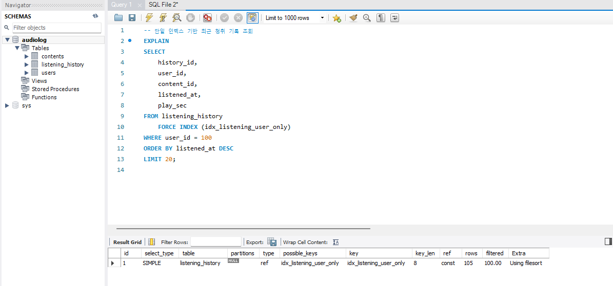

# 04. 인덱스 성능 비교

## 무엇을 하려고 했나요?
특정 회원의 **최근 청취 기록 20건**을 찾을 때 어떤 인덱스가 더 적합한지 비교했습니다.

인덱스는 책의 색인처럼 원하는 데이터를 더 쉽게 찾도록 돕는 기능입니다.

## 조회에 사용한 SQL
```sql
SELECT history_id, user_id, content_id, listened_at, play_sec
FROM listening_history
WHERE user_id = 100
ORDER BY listened_at DESC
LIMIT 20;
```

`WHERE`는 회원 ID가 100인 기록만 찾고, `ORDER BY`는 최근 날짜순으로 정렬하며, `LIMIT 20`은 20건만 보여줍니다.

## 어떻게 비교했나요?
- **단일 인덱스 `(user_id)`:** 회원 ID로 찾는 데 사용합니다. 실행 계획에서 별도의 정렬 작업(`Using filesort`)이 나타났습니다.
- **복합 인덱스 `(user_id, listened_at DESC)`:** 회원 ID와 청취 날짜를 함께 사용합니다. 이번 실행 계획에서는 별도의 정렬 작업이 나타나지 않았습니다.

실행 계획은 **MySQL이 데이터를 어떻게 찾는지 보여주는 정보**입니다.

### 단일 인덱스 실행 계획


### 복합 인덱스 실행 계획


## 측정 결과
두 인덱스를 각각 지정해 같은 조회를 **5회씩** 측정했습니다. 단위는 ms(밀리초, 1,000분의 1초)입니다.

| 회차 | 단일 인덱스 (ms) | 복합 인덱스 (ms) |
|---|---:|---:|
| 1 | 0.209 | 0.189 |
| 2 | 0.202 | 0.193 |
| 3 | 0.211 | 0.196 |
| 4 | 0.198 | 0.191 |
| 5 | 0.211 | 0.197 |
| **평균** | **0.2062** | **0.1932** |

**이번 실습에서의 평균 시간 차이: 0.013ms(약 6.3% 감소)**

## 배운 점
검색 조건뿐 아니라 **정렬에 사용하는 컬럼**도 고려해 인덱스를 만들 수 있다는 점을 배웠습니다.

다만 차이가 아주 작고 5회만 측정했으므로, 어떤 환경에서나 6.3% 빨라진다는 뜻은 아닙니다.

**사용한 SQL:** [인덱스 비교](../sql/03_index_tuning.sql)
