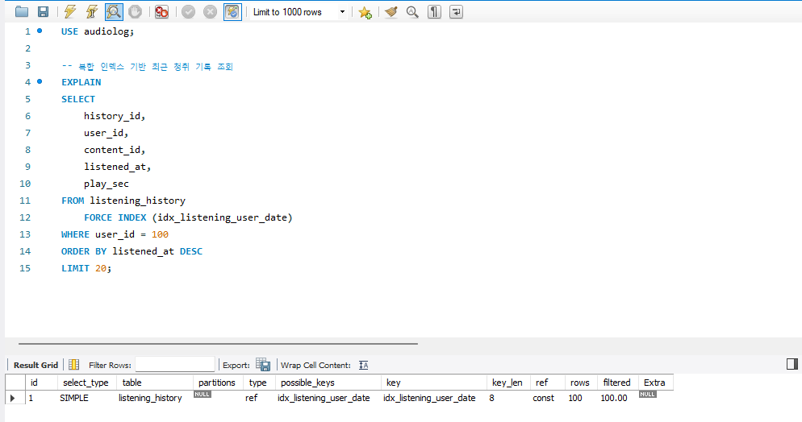

# 04. 인덱스 성능 비교

## 목표
특정 회원의 최근 청취 기록 20건을 더 빠르게 조회할 수 있는지 비교했습니다.

```sql
SELECT history_id, user_id, content_id, listened_at, play_sec
FROM listening_history
WHERE user_id = 100
ORDER BY listened_at DESC
LIMIT 20;
```

## 비교한 인덱스
- **단일 인덱스:** `(user_id)` — 회원을 찾는 데 사용합니다. 실행 계획에 별도 정렬 작업(`Using filesort`)이 나타났습니다.
- **복합 인덱스:** `(user_id, listened_at DESC)` — 회원을 찾고 최신순으로 읽을 수 있도록 구성했습니다. 비교 실행 계획에서는 `Using filesort`가 나타나지 않았습니다.

### 단일 인덱스 실행 계획


### 복합 인덱스 실행 계획


## 실제 측정 결과
같은 조회를 두 인덱스에 각각 지정하고 `EXPLAIN ANALYZE`로 **5회씩** 측정했습니다. 값은 맨 위 실행 단계의 종료 시간입니다.

| 회차 | 단일 인덱스 (ms) | 복합 인덱스 (ms) |
|---|---:|---:|
| 1 | 0.209 | 0.189 |
| 2 | 0.202 | 0.193 |
| 3 | 0.211 | 0.196 |
| 4 | 0.198 | 0.191 |
| 5 | 0.211 | 0.197 |
| **평균** | **0.2062** | **0.1932** |

**측정된 평균 차이:** 0.013ms, 약 6.3% 감소

## 결과 해석
복합 인덱스에서 정렬 작업이 줄었고 측정 평균 시간도 짧았습니다. 하지만 시간 차이가 매우 작기 때문에 실제 서비스에서도 언제나 6.3% 빨라진다고 말할 수는 없습니다.

**SQL:** [인덱스 비교](../sql/03_index_tuning.sql)
