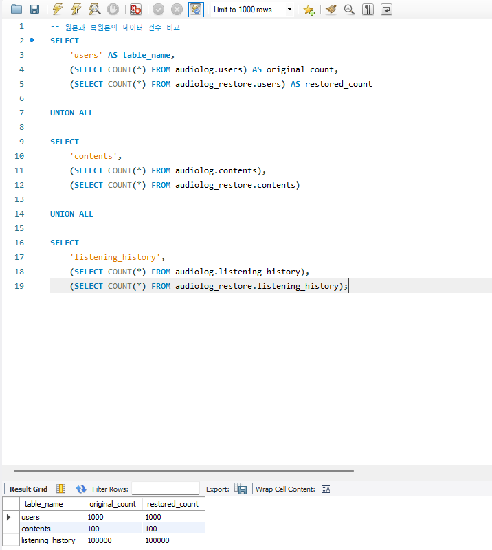
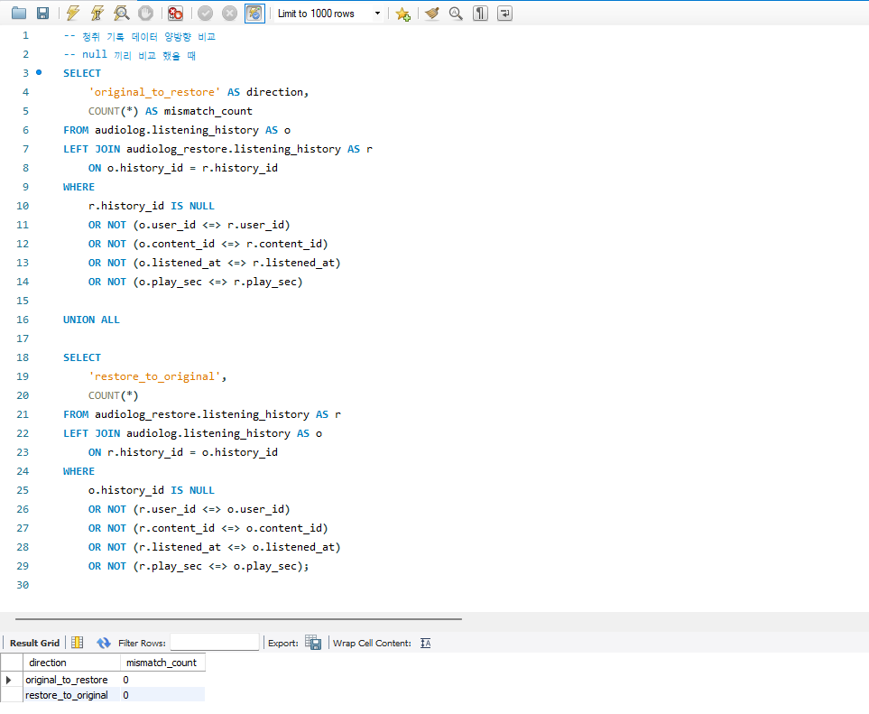

# 05. 백업·복원 검증

## 목적
백업 파일을 만든 후, **정말로 다시 복원할 수 있는지** 확인했습니다.

## 진행 방식
1. `mysqldump`로 원본 DB(`audiolog`)를 백업했습니다.
2. 백업 파일 크기 **4,221,131 Byte**를 확인했습니다.
3. 새 DB(`audiolog_restore`)에 백업 파일을 복원했습니다.
4. 원본과 복원본의 건수 및 저장된 값을 비교했습니다.

### 테이블별 건수 비교


| 테이블 | 원본 | 복원본 |
|---|---:|---:|
| 회원 | 1,000 | 1,000 |
| 콘텐츠 | 100 | 100 |
| 청취 기록 | 100,000 | 100,000 |

### 실제 데이터 비교


- 원본에서 복원본을 확인하고, 반대 방향으로도 확인했습니다.
- 데이터 내용이 다른 행은 **0건**이었습니다.
- 존재하지 않는 회원이나 콘텐츠를 가리키는 청취 기록도 **0건**이었습니다.
- 제약조건과 인덱스 구성도 비교했습니다.

## 새롭게 배운 SQL: `<=>`
원본과 복원본을 비교하면서 **NULL까지 비교할 수 있는 `<=>` 연산자**를 배웠습니다.

일반적인 `=`는 NULL이 들어가면 결과가 NULL이지만, `<=>`는 값이 같은지 참/거짓으로 판단합니다. **두 값이 모두 NULL이면 같다고 판단합니다.**

```sql
-- 청취 시간이 서로 다른 행 확인
NOT (o.play_sec <=> r.play_sec)
```

이 조건은 두 값이 다를 때 참이 됩니다. 값이 하나만 NULL인 경우도 차이로 찾을 수 있습니다.

## 배운 점
**백업 파일이 있다는 사실과 복원이 성공했다는 사실은 다릅니다.** 따라서 복원 후 건수뿐 아니라 실제 데이터도 확인해야 한다는 점을 배웠습니다.

이번 결과는 실습 당시의 검증이며, 정기 백업이나 자동 복구 시스템을 만든 것은 아닙니다.

**사용한 SQL:** [복원 데이터 비교](../sql/04_restore_validation.sql)
