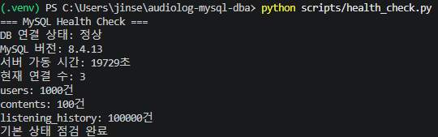

# 06. Python 기본 상태 점검

## 무엇을 하려고 했나요?
Python으로 MySQL에 접속해 DB의 기본 상태를 한 번에 확인했습니다.

## 무엇을 확인했나요?
| 항목 | 의미 |
|---|---|
| DB 연결 | MySQL에 정상적으로 접속할 수 있는지 |
| MySQL 버전 | 어떤 버전을 사용 중인지 |
| 서버 가동 시간 | 서버가 실행된 뒤 얼마나 시간이 지났는지 |
| 현재 연결 수 | MySQL에 연결된 수가 몇 개인지 |
| 테이블 건수 | 회원, 콘텐츠, 청취 기록이 각각 몇 건인지 |

### 실행 화면

## 실행 당시 결과
| 항목 | 확인한 값 |
|---|---|
| DB 연결 | 정상 |
| MySQL 버전 | 8.4.13 |
| 서버 가동 시간 | 15,314초 |
| 현재 연결 수 | 3개 |
| 회원 / 콘텐츠 / 청취 기록 | 1,000 / 100 / 100,000건 |

가동 시간과 연결 수는 실행할 때마다 달라집니다.

## 배운 점
여러 상태를 매번 직접 조회하지 않고, Python 코드 한 번으로 확인하는 방법을 배웠습니다.

다만 이 코드는 **기본 정보를 보여주는 도구**입니다. 장애를 자동으로 감지하거나 알림을 보내는 기능은 없습니다.

**사용한 Python:** [health_check.py](../scripts/health_check.py)
